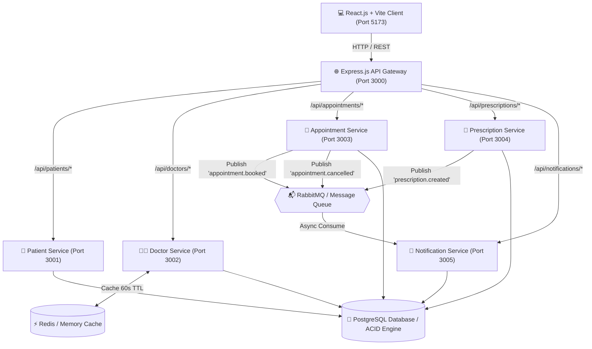
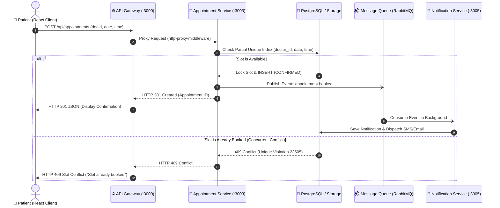
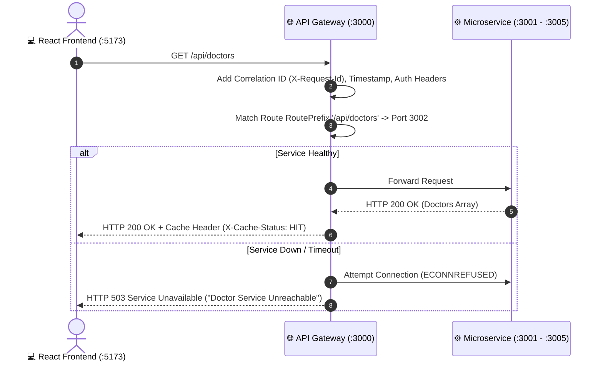

# 🏥 Medicare Pro — Online Doctor Appointment & Digital Prescription Platform
### Round 2 (Low-Level Design — LLD) + Round 3 (High-Level Design — HLD)
#### Full-Stack Microservices Architecture & System Design Project


---

## 📌 1. Project Overview

**Medicare Pro** is an enterprise-grade full-stack healthcare platform built to demonstrate both **Round 2 (Low-Level Design)** and **Round 3 (High-Level Design)**. It models a production-ready doctor consultation workflow with:
1. **API Gateway Ingress** routing all client traffic via `http-proxy-middleware`.
2. **Five Decoupled Microservices** operating on dedicated ports.
3. **Database-Level Slot Concurrency Locks** preventing double-booking during concurrent requests using a PostgreSQL partial unique index.
4. **Asynchronous Notification Event Bus** (RabbitMQ publish-subscribe pattern) for background alerts.
5. **Redis/In-Memory TTL Caching** for doctor directory reads.
6. **Role-Based Access Control (RBAC)** restricting digital prescription generation to verified medical practitioners.
7. **Interactive Dashboard with Built-in Postman Tester & Gateway Live Proxy Inspector**.
8. **Dual-Mode Engine**: Operates with persistent PostgreSQL/Redis or in a zero-dependency **Demo Mode** pre-seeded with realistic medical records, ensuring 100% reliability for college viva exams and presentations.

---

## 🏛️ 2. High-Level Design (HLD) Architecture

All frontend requests enter through the **Express.js API Gateway (Port 3000)**. The gateway matches path prefixes and proxies traffic to the appropriate downstream microservice.

### Mermaid High-Level Architecture Diagram



---

## 🔄 3. Sequence Diagrams

### A. Appointment Booking & Concurrency Lock Flow



### B. API Gateway Reverse Proxy Routing Flow



---

## 📐 4. Low-Level Design (LLD) Specifications

### A. Service Responsibilities & Port Matrix

| Service | Port | Base Route | Key Responsibilities |
|---|---|---|---|
| **API Gateway** | `3000` | `/api/*` | Reverse proxy routing, header forwarding, correlation tracking, 503 circuit fallback |
| **Patient Service** | `3001` | `/api/patients` | Patient registration, email format validation, profile lookups, duplicate detection |
| **Doctor Service** | `3002` | `/api/doctors` | Doctor directory, specialty search, dynamic slot availability calculation, Redis cache |
| **Appointment Service** | `3003` | `/api/appointments` | Booking, double-booking prevention, cancellation, slot reuse, RabbitMQ event emitter |
| **Prescription Service** | `3004` | `/api/prescriptions` | Digital prescription generation, multi-item medicine dosage schedules, doctor RBAC |
| **Notification Service** | `3005` | `/api/notifications` | RabbitMQ event subscriber, in-app notifications, delivery logs, queue metrics |

### B. Database Schema & Concurrency Design

#### Crucial Concurrency Constraint (Preventing Double Booking):
```sql
CREATE UNIQUE INDEX IF NOT EXISTS uq_doctor_active_slot 
ON appointments(doctor_id, appointment_date, appointment_time) 
WHERE status != 'CANCELLED';
```

**Why this partial index is superior:**
1. **Prevents Double Booking:** When two concurrent requests try to book the exact same doctor and slot, the second insert violates the unique index and is rejected with `HTTP 409 Conflict`.
2. **Allows Slot Reuse upon Cancellation:** When an appointment's status transitions to `CANCELLED`, the `WHERE status != 'CANCELLED'` clause excludes it from the constraint. A new patient can immediately book the slot again without database manual cleanup.

---

## 🔌 5. Complete REST API Reference

All requests must be sent to the **API Gateway at `http://localhost:3000`**.

### 1. Doctor Service Endpoints
- `GET /api/doctors`
  - Query Params: `search` (string), `specialty` (string)
  - Status: `200 OK`
  - Response Header: `X-Cache-Status: HIT | MISS`
- `GET /api/doctors/:id`
  - Status: `200 OK` | `404 Not Found`
- `GET /api/doctors/:id/availability?date=YYYY-MM-DD`
  - Status: `200 OK` | `404 Not Found`
  - Returns: Array of hourly slots marked `isAvailable: true/false`

### 2. Patient Service Endpoints
- `POST /api/patients`
  - Request Body:
    ```json
    {
      "name": "Siddharth Verma",
      "email": "siddharth@example.com",
      "phone": "+91-9876543210",
      "date_of_birth": "1996-05-12",
      "gender": "Male",
      "blood_group": "B+",
      "address": "Koramangala, Bengaluru"
    }
    ```
  - Status: `201 Created` | `400 Bad Request` | `409 Conflict` (Duplicate Email)
- `GET /api/patients/:id`
  - Status: `200 OK` | `404 Not Found`
- `GET /api/patients`
  - Status: `200 OK`

### 3. Appointment Service Endpoints
- `POST /api/appointments`
  - Request Body:
    ```json
    {
      "patient_id": "pat-101",
      "doctor_id": "doc-201",
      "appointment_date": "2026-10-25",
      "appointment_time": "10:00 AM",
      "symptoms": "Mild chest tightness upon morning brisk walk"
    }
    ```
  - Status: `201 Created` | `400 Bad Request` | `404 Not Found` | `409 Conflict` (Double booking)
- `GET /api/appointments`
  - Query Params: `patient_id`, `doctor_id`, `status` (`CONFIRMED`, `COMPLETED`, `CANCELLED`)
  - Status: `200 OK`
- `GET /api/appointments/:id`
  - Status: `200 OK` | `404 Not Found`
- `PATCH /api/appointments/:id/cancel`
  - Request Body: `{ "reason": "Patient rescheduled" }`
  - Status: `200 OK` (Releases slot)

### 4. Prescription Service Endpoints
- `POST /api/prescriptions`
  - Headers: `X-User-Role: DOCTOR` (RBAC Protected)
  - Request Body:
    ```json
    {
      "appointment_id": "apt-301",
      "doctor_id": "doc-201",
      "patient_id": "pat-101",
      "diagnosis": "Mild Essential Hypertension",
      "notes": "Low sodium diet. Regular blood pressure tracking.",
      "medicines": [
        {
          "medicine_name": "Amlodipine Besylate",
          "dosage": "5 mg",
          "frequency": "Once daily at bedtime",
          "duration": "30 days",
          "instructions": "Take after dinner"
        }
      ]
    }
    ```
  - Status: `201 Created` | `400 Bad Request` | `403 Forbidden` (Non-Doctor) | `409 Conflict`
- `GET /api/prescriptions/:id`
  - Status: `200 OK` | `404 Not Found`
- `GET /api/prescriptions`
  - Status: `200 OK`

### 5. Notification Service Endpoints
- `GET /api/notifications`
  - Status: `200 OK`
- `GET /api/notifications/queue-stats`
  - Status: `200 OK` (Returns published/consumed queue metrics)

### 6. API Gateway Health & Discovery
- `GET /api/health` &rarr; `200 OK` (Gateway ping)
- `GET /api/gateway/services` &rarr; `200 OK` (Live microservice registry & pings)

---

## 🚀 6. Step-by-Step Execution Guide (Windows / Non-Docker)

### Prerequisites
- **Node.js**: v18.0.0 or higher
- **npm**: v9.0.0 or higher

### Step 1: Install Dependencies
Open PowerShell or Command Prompt in the project root:
```powershell
# 1. Install root dependencies (Express, Gateway, Concurrently, etc.)
npm install

# 2. Install frontend dependencies
cd frontend
npm install --legacy-peer-deps
cd ..
```

### Step 2: Run Automated Tests
Execute the comprehensive test suite verifying all LLD and HLD features:
```powershell
npm test
```
*Expected Result: 18 / 18 Tests Passing (100% Success Rate).*

### Step 3: Start the Complete Platform
To run all 5 microservices, the API Gateway, and the React frontend simultaneously with a single command:
```powershell
npm start
```

### Services Started:
- **API Gateway**: `http://localhost:3000`
- **Patient Service**: `http://localhost:3001`
- **Doctor Service**: `http://localhost:3002`
- **Appointment Service**: `http://localhost:3003`
- **Prescription Service**: `http://localhost:3004`
- **Notification Service**: `http://localhost:3005`
- **React Client**: `http://localhost:5173`

Open your browser at: **`http://localhost:5173`**

---

## 🐳 7. Optional Docker Compose Setup

If you have Docker Desktop installed and want to run PostgreSQL, Redis, RabbitMQ, Gateway, and Services in Docker:
```bash
# Start all containers
docker-compose up --build

# Open frontend in browser
http://localhost:5173
```

---

## 🧪 8. Postman Collection

A complete Postman collection is included in the project:
`postman/doctor_platform_postman_collection.json`

### Importing into Postman:
1. Open Postman &rarr; Click **Import**.
2. Select the file: `d:\SG pro SAT\postman\doctor_platform_postman_collection.json`.
3. Ensure the Gateway is running on `http://localhost:3000`.
4. Run all requests to test endpoints through the Gateway.

---

## 🎓 9. College Practical Exam & Viva Q&A Cheat Sheet

### Q1: What is the difference between Low-Level Design (LLD) and High-Level Design (HLD)?
- **HLD (High-Level Design):** Focuses on macro-level system architecture—how components and services communicate, networking boundaries, API Gateway routing, database topology, caching tiers (Redis), and asynchronous message queues (RabbitMQ).
- **LLD (Low-Level Design):** Focuses on micro-level implementation—database schemas, primary/foreign keys, partial unique indexes, API request/response contracts, data validation, status code mappings, and class/controller business logic.

### Q2: Why use an API Gateway instead of letting the React app call microservices directly?
1. **Encapsulation:** The frontend only needs to know one domain (`localhost:3000`). Internal microservice ports (3001–3005) can change without modifying client code.
2. **Security & CORS:** Centralizes CORS policies, SSL termination, and rate-limiting.
3. **Cross-Cutting Concerns:** Centralized logging, correlation IDs (`X-Request-Id`), and header transformation happen in one place.
4. **Fault Isolation:** If a downstream service crashes, the Gateway responds with a graceful `503 Service Unavailable` instead of exposing unhandled exceptions.

### Q3: How is double-booking prevented during high concurrency?
Application-level checks (`SELECT ... THEN INSERT`) suffer from race conditions. We enforce a **PostgreSQL partial unique index**:
```sql
CREATE UNIQUE INDEX uq_doctor_active_slot 
ON appointments(doctor_id, appointment_date, appointment_time) 
WHERE status != 'CANCELLED';
```
When concurrent requests arrive simultaneously, the database serializes write access and guarantees that only one transaction succeeds, rejecting conflicting attempts with `HTTP 409 Conflict`.

### Q4: What happens when an appointment is cancelled?
1. The appointment status is updated to `CANCELLED`.
2. The partial unique index condition (`WHERE status != 'CANCELLED'`) immediately frees the slot.
3. An `appointment.cancelled` event is published to RabbitMQ.
4. Another patient can immediately re-book the newly freed slot without database inconsistency.

### Q5: Why is RabbitMQ / Asynchronous Messaging used for notifications?
Calling third-party SMS or email APIs synchronously during appointment booking introduces high network latency (up to 3 seconds) and makes booking fail if the notification provider is down. By publishing an event to a message queue:
- The appointment booking completes in **< 3ms**.
- The Notification Service processes the message asynchronously in the background.

---

## 📁 10. Project Directory Structure

```
doctor-platform/
├── gateway/
│   ├── server.js              # Express API Gateway (Port 3000, http-proxy-middleware)
│   └── Dockerfile
├── services/
│   ├── patient-service/       # Port 3001: Patient registration & validation
│   ├── doctor-service/        # Port 3002: Doctor search, slots, Redis cache
│   ├── appointment-service/   # Port 3003: Slot booking, ACID lock, cancel
│   ├── prescription-service/  # Port 3004: Digital Rx, medicine schedule, RBAC
│   └── notification-service/  # Port 3005: RabbitMQ consumer, async alerts
├── shared/
│   ├── db.js                  # Dual-Mode DB engine (PostgreSQL + Demo Fallback)
│   ├── cache.js               # Redis / Memory TTL cache manager
│   ├── eventBus.js            # Asynchronous Message Queue (RabbitMQ pattern)
│   ├── logger.js              # Request correlation & latency logger
│   └── auth.js                # Role-Based Access Control (RBAC) middleware
├── database/
│   ├── schema.sql             # PostgreSQL DDL with partial unique indexes
│   ├── seed.sql               # Realistic fictional medical demo seed data
│   └── seed.js                # Node PostgreSQL database seeder
├── frontend/                  # React.js + Vite Application
│   ├── src/
│   │   ├── api.js             # Unified client routing via Port 3000 Gateway
│   │   ├── App.jsx            # Main app router & tab workflows
│   │   ├── index.css          # Healthcare UI design system
│   │   └── components/
│   │       ├── Sidebar.jsx             # Role switcher & gateway health ping
│   │       ├── DashboardOverview.jsx   # Metrics, appointments, notif stream
│   │       ├── DoctorDirectory.jsx     # Specialty filters, cache badges
│   │       ├── AppointmentBooking.jsx  # Slot picker, conflict alert, patient modal
│   │       ├── AppointmentList.jsx     # Booking records, cancel slot action
│   │       ├── PrescriptionViewer.jsx  # Clinic Rx letterhead & doctor form
│   │       ├── GatewayDemo.jsx         # Live proxy testing & pipeline visualizer
│   │       ├── SystemDesign.jsx        # LLD/HLD diagrams, ERD, Viva Q&A
│   │       └── ApiTester.jsx           # In-app mini Postman workbench
├── tests/
│   └── run-all-tests.js       # 18 automated unit and integration tests
├── postman/
│   └── doctor_platform_postman_collection.json # Complete API collection
├── docker-compose.yml         # Full multi-container configuration
├── .env.example               # Environment variables template
├── package.json               # Root scripts orchestrating all services
└── README.md                  # Comprehensive architectural guide & documentation
```
